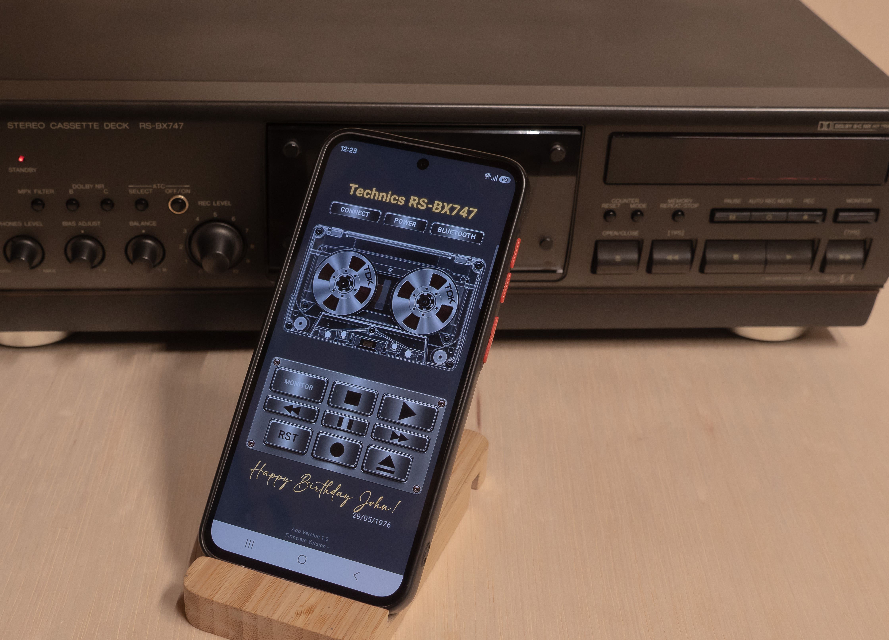

# RemoteStudio

### Vintage Soul. Modern Technology.

**Bluetooth Remote Control App for the Technics RS-BX747 Vintage Cassette Deck**

RemoteStudio is a custom-developed Android application designed to bring modern wireless control to classic vintage audio equipment.

Originally developed for a restored and electronically upgraded Technics RS-BX747 cassette deck, RemoteStudio combines the nostalgic experience of analog audio with the convenience of modern Bluetooth technology.

---

## Download RemoteStudio

**[Download the Latest Android APK](https://github.com/luci295/RemoteStudio/releases/latest)**

The application is available as a signed Android APK and can be installed directly on compatible Android smartphones.

**No Google Play Store account or registration required.**

---

## Main Features

### Bluetooth Remote Control

Control the upgraded Technics RS-BX747 directly from your Android smartphone.

Available controls include:

- Play, Stop, Pause, Fast Forward and Rewind
- Record and cassette Eject
- Power control
- Monitor (Source/Tape) selection
- Bluetooth audio transmitter control

### Integrated Bluetooth Audio Transmitter

The upgraded cassette deck includes a dedicated Bluetooth audio transmitter.

Enjoy your cassette recordings through compatible Bluetooth headphones or speakers.

The RemoteStudio app allows you to turn the transmitter on or off and initiate reconnection.

### Personalized Display

Make your vintage audio experience unique!

RemoteStudio allows you to customize:

- **Title** — Personalize the name displayed at the top of the application.
- **Personal Message** — Add a birthday greeting, anniversary message, or custom dedication.
- **Special Date** — Display a memorable date.

Personalized information is stored in the deck's electronic controller and synchronized with compatible Android smartphones.

### Vintage-Inspired Design

The application features a classic cassette-inspired interface with animated tape reels, carefully designed to complement the appearance of the original Technics cassette deck.

---

## Installation Instructions

1. Open the [Latest Release](https://github.com/luci295/RemoteStudio/releases/latest) page.
2. Expand the **Assets** section.
3. Download `RemoteStudio-v1.0.0.apk` or the latest available APK version.
4. Open the downloaded APK file on your Android smartphone.
5. If requested, allow installation from your browser or file manager.
6. Complete the installation.
7. Enable Bluetooth and launch RemoteStudio.
8. Connect to your compatible upgraded cassette deck.

---

## Compatibility

**Important:** RemoteStudio is designed for audio equipment equipped with the compatible RemoteStudio electronic control system.

The current application version is developed specifically for the **Technics RS-BX747**.

It will not remotely control an original, unmodified cassette deck.

The Bluetooth audio transmitter is installed inside the upgraded deck. Audio is transmitted directly from the deck to compatible Bluetooth audio devices, not through the smartphone application.

---

## Custom Electronic Upgrade

The RemoteStudio control system is based on an ESP32 microcontroller and a custom-designed electronic circuit board.

The system combines wireless control, infrared communication, and electronic switching capabilities.

The PCB is professionally manufactured and integrated into the vintage equipment using a removable mounting system and detachable connectors, allowing easier future servicing.

The electronic control platform was designed with future adaptations to other vintage audio equipment in mind.

---

## Updates

New versions of RemoteStudio will be published in the **Releases** section of this repository.

**[Check for the Latest Version](https://github.com/luci295/RemoteStudio/releases/latest)**

This repository distributes the Android application installer. The application source code and ESP32 firmware are not included.

---

## Developer

**Cordea Lucian**

Custom Electronics • Vintage Audio Modernization • Bluetooth Control Systems

*Bringing classic audio equipment into the modern world.*
